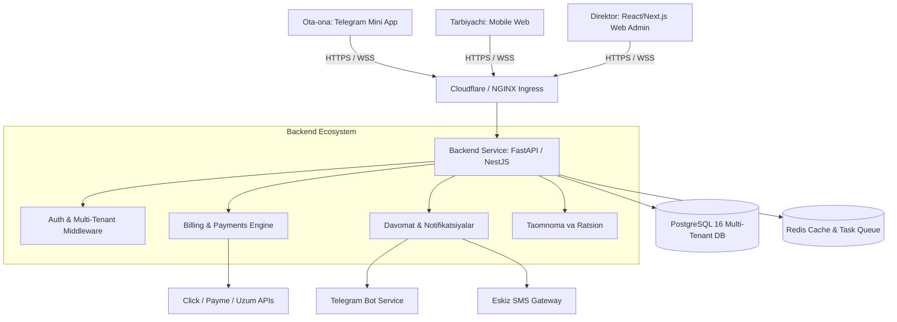

# Bog'chaOS: Tizim Arxitekturasi va Backend Standartlari

Ushbu hujjat Bog'chaOS SaaS platformasining server arxitekturasi, ma'lumotlar xavfsizligi, API tuzilishi va tashqi tizimlar (Telegram, Click/Payme) bilan integratsiyasini belgilaydi.

---

### 1. Umumiy Arxitektura Diagrammasi



---

### 2. Multi-Tenancy (Ko'p ijarachilik) Modeli

Bog'chaOS **"Shared Database, Shared Schema with Tenant Discriminator"** yondashuvidan foydalanadi:
* Har bir asosiy jadvalda `org_id` (UUID) ustuni mavjud.
* **Xavfsizlik:** PostgreSQL **Row-Level Security (RLS)** orqali ta'minlanadi.
* Har bir so'rov kelganda, JWT token ichidagi `org_id` tekshiriladi va DB sessiyasiga o'rnatiladi:
  ```sql
  SET LOCAL app.current_org_id = 'a0000000-0000-0000-0000-000000000001';
  ```
* Bu orqali bitta bog'chaning xodimlari ikkinchi bog'chaning ma'lumotlarini (bolalar, summalar, telefonlar) tasodifan ham ko'ra olmaydi.

---

### 3. API Spetsifikatsiyasi (Asosiy REST Endpoints)

#### 3.1. Autentifikatsiya (Auth)
* `POST /api/v1/auth/login` — Telefon raqam va parol orqali tizimga kirish (JWT Access & Refresh token).
* `POST /api/v1/auth/telegram-auth` — Telegram Web App orqali tezkor kirish (hash tekshiruvi bilan).

#### 3.2. Bolalar va Guruhlar
* `GET /api/v1/groups` — Bog'chadagi barcha guruhlar ro'yxati.
* `POST /api/v1/groups` — Yangi guruh ochish.
* `GET /api/v1/children?group_id={id}&search={query}` — Bolalar ro'yxati (filtrlar bilan).
* `POST /api/v1/children` — Yangi bola qabul qilish.
* `GET /api/v1/children/{id}` — Bolaning shaxsiy kartasi, tibbiy qaydlari va to'lov holati.

#### 3.3. Jonli Davomat (Attendance)
* `GET /api/v1/attendance?date={YYYY-MM-DD}&group_id={id}` — Tanlangan sanadagi davomat.
* `POST /api/v1/attendance/batch` — Guruh bo'yicha bir vaqtning o'zida davomatni tasdiqlash:
  ```json
  {
    "date": "2026-10-02",
    "group_id": "g0000000-0000-0000-0000-000000000001",
    "records": [
      {"child_id": "c0000000-0000-0000-0000-000000000001", "status": "PRESENT", "check_in_time": "08:15"},
      {"child_id": "c0000000-0000-0000-0000-000000000002", "status": "ABSENT", "notes": "Shamollagan"}
    ]
  }
  ```
* Bu endpoint chaqirilishi bilan orqa fonda (background queue) ota-onalarga Telegram bot orqali avtomatik xabar yuboriladi.

#### 3.4. Moliya va To'lovlar (Billing)
* `GET /api/v1/invoices?period=2026-10&status=UNPAID` — Qarzdorlar ro'yxati.
* `POST /api/v1/invoices/generate-monthly` — Oylik hisoblarni avtomatik shakllantirish (oyning 1-sanasida).
* `POST /api/v1/payments/cash` — Qo'ldan (naqd) olingan to'lovni tasdiqlash va kvitansiya chiqarish.
* `POST /api/v1/payments/webhook/click` — Click to'lov tizimi webhook handleri.
* `POST /api/v1/payments/webhook/payme` — Payme to'lov tizimi webhook handleri.

#### 3.5. Taomnoma va Oshxona
* `GET /api/v1/meals/today` — Bugungi kunlik taomnoma va ratsion.
* `POST /api/v1/meals/calculate-supplies` — Bugun kelgan bolalar soniga qarab go'sht, sut, meva va non sarfini hisoblash.

---

### 4. Telegram Bot & Webhook Oqimi

1. Ota-ona botga `/start` bosadi.
2. Bot telefon raqamini tasdiqlashni so'raydi (`Send Contact` tugmasi).
3. Telefon raqam `parents` jadvalidan qidiriladi:
   * Agar topilsa: `parents.telegram_chat_id` saqlanadi va bog'cha nomi bilan salomlashuv xabari chiqadi.
   * `Telegram Web App (TMA)` tugmasi paydo bo'ladi.
4. Har gal bola davomatda "Keldi" deb belgilanganda:
   ```
   🎉 Assalomu alaykum, Xurshid aka!
   Farzandingiz Imron soat 08:20 da 'Smart Kids' bog'chasiga yetib keldi.
   
   Bugungi taomnoma:
   🥣 Nonushta: Mannaya kasha, sariyog'li non
   🍲 Tushlik: No'xat sho'rva, qovurilgan tovuq go'shti
   ```
